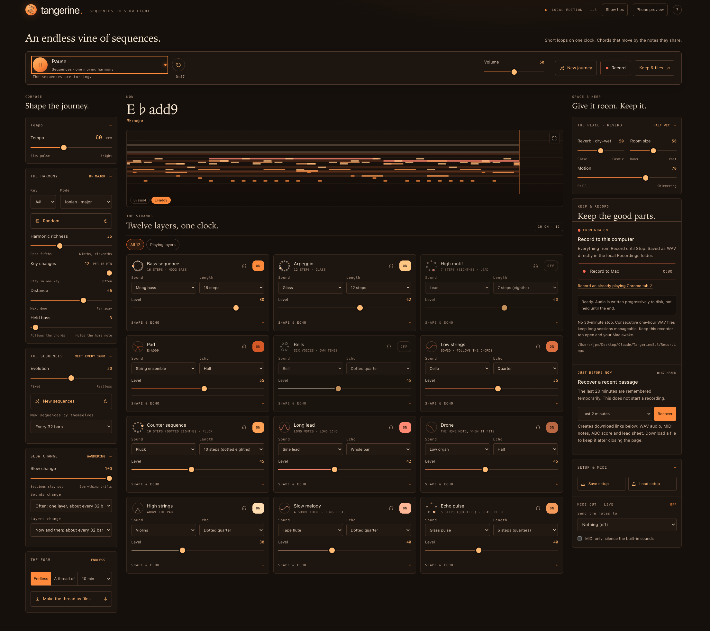

# Tangerine — sequences in slow light

**An endless vine of electronic sequences and slow, tonal harmony, for your browser. Twelve synthesized layers turn on one clock; the chords move by the notes they share, and now and then the whole vine travels to another key.**

**[▶ Play in your browser](https://quick-eyed-sky.github.io/tangerine/)** · **[⬇ Download Tangerine 1.3.0](https://github.com/Quick-Eyed-Sky/tangerine/releases/tag/v1.3.0)** · [French guide](LISEZ-MOI.md) · [First opening on a Mac](docs/first-opening.md)



*The local edition playing, with New journey in the top bar.*

*Loopra’s electric sibling. Every sound is synthesized in the browser. Free and open source, with an English interface.*

## What’s new in 1.3

- **An interface for phones, laptops and large screens.** On a large screen, composition lives on the left, the animated score and layers in the centre, and space and recording on the right. On a phone, switch between **Play**, **Compose** and **Keep & Record** without restarting the music. Playback and master volume stay within reach.
- **Full-screen animated score on phones too**, in portrait or landscape, with Play/Pause and a return button. A page-filling view is available when native fullscreen is unavailable.
- **Tempo from 6 to 140 BPM**, starting at 60. At 6 BPM, one beat lasts ten seconds. Timed threads respect the engine’s existing twelve-bar minimum; shorter choices are unavailable at very slow tempos. Echo delay retains its existing maximum of 3.9 seconds.
- **New journey is next to playback.** It draws another seed while keeping your harmony, tempo, layer settings and listening timer. **Restart from zero**, the round arrow, also resets the timer and draws a new key, mode and harmony settings.
- **Keep and Record now describe different actions.** Recover a recent passage looks back; Record starts capturing from now.
- **Continuous local WAV recording.** With the downloaded edition and its Python launcher, sound is written progressively to your computer until you stop. Consecutive one-hour WAV files allow long sessions without retaining the entire recording in browser memory. This feature records audio; it does not create a full-session MIDI or ABC file.

The musical engine, synthesis, harmony rules, effects and note-export modules are unchanged from 1.2. This release changes the interface, initial settings and recording workflow.

## Start listening

**Online:** open [the demo](https://quick-eyed-sky.github.io/tangerine/) and click **Start the vine**. The browser requires a click before making sound. Desktop Chrome is recommended for the widest feature support. On iPhone, check silent mode and media volume if the page appears to play without sound; phone audio behaviour still depends on the browser and system.

**On your computer:** download `Tangerine-v1.3.0.zip` from the [release](https://github.com/Quick-Eyed-Sky/tangerine/releases/tag/v1.3.0), unzip it and keep the whole folder together. Python 3 is required; there are no packages to install.

- On a Mac, double-click **Tangerine.command**. See [first opening](docs/first-opening.md) if macOS asks you to confirm a downloaded launcher.
- On macOS or Linux, run `./run.sh`.
- Or run `python3 scripts/serve.py --open` from the extracted folder.

The launcher chooses a free loopback port starting at **4350** and distinguishes different copies of Tangerine. Keep its Terminal window open while listening or recording.

Press **Space** to play or pause when you are not using another control. **Show tips** reveals the longer explanations. On a computer, **Phone preview** tries the phone layout without reloading the page.

## Keep & Record

| Action | What is saved | Where and when |
| --- | --- | --- |
| **Recover a recent passage** | The last 30 seconds to 20 minutes, as WAV audio, MIDI notes, ABC score and a lead sheet, where capture is supported | Download links appear under recent passages. Click them before closing the tab. |
| **Record a passage — online demo** | From now until Stop, up to 30 minutes, held in browser memory | Download the files when the passage ends. |
| **Record to this computer — local download** | Audio from Record until Stop, written progressively as stereo PCM 16-bit WAV | Files are saved automatically in `Recordings/`, next to the launcher, in a dated session folder. Each hour continues in the next WAV file. |
| **Record an already playing Chrome tab — local download** | The shared tab’s audio from capture start until Stop | Choose the tab and enable **Share tab audio** in Chrome. It is not reloaded. No video or microphone input is recorded. |

**“All available (up to 20 min)” means the audio still in the recent-memory buffer, not an arbitrarily long session since its beginning.** Closing the page removes temporary browser download links. Local continuous files already written to disk remain on your computer.

For a long local recording, keep the recorder tab and Terminal open, keep the computer awake and check that there is enough disk space. Stop recording with **Stop & finish files** to finish the last audio block. Pausing playback records silence until playback resumes or recording stops. A system interruption can still lose an unconfirmed final block.

GitHub Pages serves static files: **it cannot run the local recording server**. The online demo therefore offers browser passage recording and a link to the local download for continuous recording.

## The instrument

Short sequences of different lengths keep meeting in new places: bass, arpeggio, high motif, dotted-eighth counter sequence and quarter-note echo pulse. A pad, low and high strings, long lead, slow melody, bells and drone move around them. No drums: the accents of the sequences are the rhythm.

- **Twelve layers**, with ON/OFF, solo headphones, sound, level, envelope and tempo-related echo controls. On a phone, **Edit sound & shape** opens the detailed settings.
- **Tonal harmony that travels** through shared chords or common tones. Key changes sets how often it moves; Distance sets how far. Harmonic richness changes the chord vocabulary.
- **Slow evolution** changes a sequence detail now and then. New sequences, sounds and layer participation can also change automatically.
- **Endless or a timed thread**, which returns home and ends. Whole threads can be rendered as notes, with offline WAV rendering for supported lengths up to 20 minutes.
- **Live MIDI out**, when supported, or MIDI only as a silent sequencer.
- **Reproducible starting points:** the same seed and settings give the same generated vine. Manual interventions and their timing also affect a live session. Save and load setups as JSON.

The 1.3 starting setup is **60 BPM, F♯ Lydian, richness 58, six key changes per ten minutes, distance 35, held bass 56, evolution 100 and slow change 100**. Sequences and sounds renew about every 32 bars, with layer rotation about every 32 bars. Other layer and effect defaults remain as in 1.2. Settings are remembered in the browser; JSON setups remain compatible with supported earlier versions.

## Previous version

**1.2 remains available:** [release and original download](https://github.com/Quick-Eyed-Sky/tangerine/releases/tag/v1.2.0) · [original source at its tag](https://github.com/Quick-Eyed-Sky/tangerine/tree/v1.2.0) · [archived 1.2 browser demo](https://quick-eyed-sky.github.io/tangerine/versions/v1.2.0/).

The archived demo is a byte-for-byte copy of the 1.2 `dist/` folder. Its interface and behaviour have not been updated. The original documentation is retained in [docs/versions/](docs/versions/).

## How it is made

Plain HTML, CSS and JavaScript, with no build step or runtime packages. `engine.js` generates the music, `theory.js` describes harmony, and `audio.js` synthesizes it. `journal.js`, `midi.js` and `abc.js` write notes and scores. The separate disk recorder taps the master output and writes PCM blocks through the local Python server.

The complete static demo is **`dist/`**. Paths are relative, including when hosted under `/tangerine/`. All sound is generated or captured locally. There are no analytics, remote fonts, external audio services, model calls or account requirements. Recordings, personal setups and development captures are excluded from releases and source publication.

With Node.js 20+ and Python 3:

```sh
npm run check
npm test
npm run test:recording
```

See [PUBLISHING.md](PUBLISHING.md) for release and GitHub Pages instructions.

## Who made this

Jean-Pascal — **[Quick-Eyed Sky](https://www.youtube.com/@QuickEyedSky)** on YouTube, **[QES](https://huggingface.co/QES)** on Hugging Face. Not a programmer: Tangerine exists for the pleasure of hearing sequences turn and meet, in the spirit of the synthesizer records of the seventies.

### Contributors

Coding assistance: **[Claude](https://github.com/claude) (Anthropic)** for the original development, and **[Codex](https://github.com/codex) (OpenAI)** for the 1.3 interface, mobile layout, recording workflow, tests and release preparation. Jean-Pascal directs the project and its musical choices.

If it gives you a good long drift, you can [buy me a coffee](https://buymeacoffee.com/oFJ5CiY7n). Entirely optional, and Tangerine stays exactly as free either way.

## License

MIT — see [LICENSE](LICENSE).
